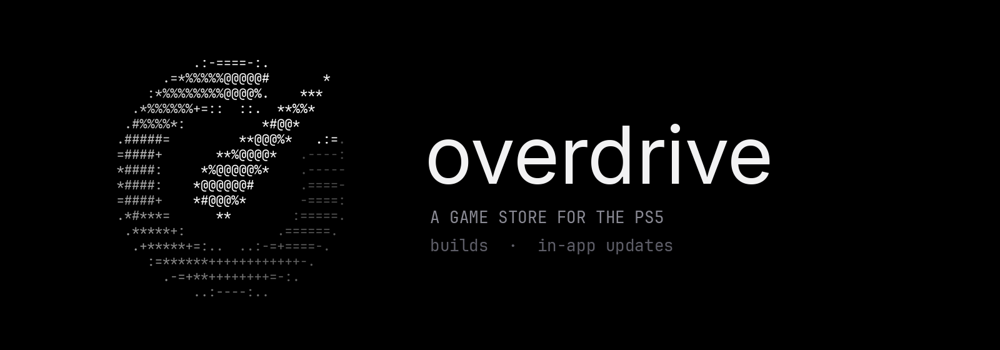

<p align="center">
  
</p>

<p align="center">
  <a href="https://github.com/half144/overdrive-releases/releases/latest"></a>
  <a href="https://github.com/half144/overdrive-releases/releases"></a>
</p>

Overdrive is a game store that runs on a jailbroken PS5. Browse the catalog, download with up to 64
connections at once, extract archives and hand finished games to ShadowMountPlus, all from the
controller.

This repository holds its builds. Install it once by hand; after that, Overdrive updates itself.

> **Support Overdrive:** You can support the project by buying the OVERDRIVE token on Solana:
> `HT1hPomeMjNM81XebDHLgiBr3upQCHSgWLmeoyU7pump`. **All fees go to the developer.**

> **Upgrading from the folder install?** It will stop getting updates soon. Follow
> [MIGRATE.md](MIGRATE.md) to switch to the single-file image.

## What you need

| | |
| --- | --- |
| **A jailbroken PS5** | Tested on firmware 13.60 |
| **[ShadowMountPlus](https://github.com/drakmor/ShadowMountPlus)** | Registers Overdrive and the games it downloads |
| **An ELF loader on port 9021** | For example John Törnblom's elfldr. Overdrive uses it to install packages, and a folder install to reopen itself after an update |
| **A way to copy files to the console** | FTP, [PS5Upload](https://github.com/phantomptr/ps5upload) or a USB drive |

## Install

1. **Download** `Overdrive-PPSA99058.exfat.zip` from the [latest release](https://github.com/half144/overdrive-releases/releases/latest).
2. **Unzip** it on your computer. You get a single file, `Overdrive-PPSA99058.exfat`: the whole app
   in one exFAT image.
3. **Copy** that file to `/data/homebrew/` on the console (or to `homebrew/` on a USB drive plugged
   into it), so you end up with `/data/homebrew/Overdrive-PPSA99058.exfat`. Do not change its
   permissions: ShadowMountPlus mounts the image as it is.
   - **FTP:** connect to the console's FTP server and upload the file into `/data/homebrew/`.
   - **PS5Upload:** send the file with `/data/homebrew/` as the destination folder.
   - **USB:** copy the file to `homebrew/` at the root of an exFAT drive and plug it into the console.
4. **Register** it: with ShadowMountPlus running, Overdrive appears on the home screen within a few
   seconds. If it does not, run ShadowMountPlus's scan again.
5. **Open** Overdrive from the home screen.

> Keep the file name `Overdrive-PPSA99058.exfat`, and keep only one copy of Overdrive: if you had
> the folder install, delete `/data/homebrew/PPSA99058` first so ShadowMount doesn't see two copies.
> [MIGRATE.md](MIGRATE.md) walks through switching from the folder install.

<details>
<summary><b>Alternative: the folder install (deprecated)</b></summary>

The folder install will stop getting updates soon; prefer the image above, or
[switch to it](MIGRATE.md) if you already have the folder.

1. Download `Overdrive-PPSA99058.zip` from the latest release and extract it: you get a folder named
   `PPSA99058`.
2. Copy the whole folder to `/data/homebrew/`, so you end up with
   `/data/homebrew/PPSA99058/eboot.bin`. Keep the folder name: it is the title ID.
3. Set the folder's permissions to `777`, recursively. FTP clients such as zftpd write files as
   `0666`, which the console's loader refuses ("Cannot start the game or app").
4. Register and open it as above.
</details>

## Updates

Overdrive checks this repository a few seconds after it opens. When a newer release is out, it
asks first:

```
UPDATE AVAILABLE
v0.0.89
v0.0.88  →  v0.0.89
[ Update now ]  [ Later ]
```

**Update now** downloads the release, checks it against the SHA-256 GitHub publishes for it,
and installs it. An image install gets the new image in place of the old one: Overdrive then
closes, and ShadowMountPlus mounts the new image when you open it again from the home screen after
a few seconds. A
folder install gets the new files swapped into its folder and reopens on its own. Your downloads,
favorites and settings stay where they are.

To update by hand instead, repeat the install steps over the existing file (or folder).

## Troubleshooting

<details>
<summary><b>"Cannot start the game or app" after copying the folder</b></summary>

Only the folder install has this: the console's launcher needs to read every file in the folder.
Set the folder's permissions to `777`, recursively (most FTP clients and PS5Upload can do it), then
open Overdrive again. The image install never needs it.
</details>

<details>
<summary><b>Overdrive closes after an update but does not reopen</b></summary>

With the image install that is expected: open Overdrive from the home screen. With the folder
install, reopening needs the ELF loader on port 9021; without it the update still installs, and
Overdrive runs the new version when you open it.

If you reopen an image install too fast, the old version may open and offer the same update again:
choose **Later**, close Overdrive and open it again after a few seconds. ShadowMountPlus releases
the old image a moment after the app closes.
</details>

<details>
<summary><b>The update dialog never appears</b></summary>

The console needs internet access to reach GitHub, and Overdrive only offers a release newer than
the version shown next to its logo. GitHub allows 60 checks an hour per network; a busy shared
connection can run out, and the next launch tries again.
</details>

<details>
<summary><b>Overdrive does not show up on the home screen</b></summary>

Check that ShadowMountPlus is running and that the path is exactly
`/data/homebrew/Overdrive-PPSA99058.exfat` (or, for the folder install,
`/data/homebrew/PPSA99058/eboot.bin`, not one folder deeper). If both the image and the
`PPSA99058` folder are there, ShadowMountPlus sees the same title twice: delete the folder.
</details>

<details>
<summary><b>Every download fails with "No connection to the server" (or "Not enough free space" with plenty of room)</b></summary>

The console can't resolve the download servers' names, so every download stops at 0 MB. Covers
may still load, because Overdrive looks their addresses up on its own; downloads use the console's
DNS.

- **DNS set to `127.0.0.1`** (common with Y2JB and other jailbreak setups): that address is a DNS
  payload running on the console, such as NanoDNS. Load it before opening Overdrive, then choose
  **Retry**.
- **Any other DNS**: set the console's DNS to `1.1.1.1` and `1.0.0.1` (or `8.8.8.8` and `8.8.4.4`)
  in **Settings > Network > Settings > Set Up Internet Connection**, then choose **Retry**.

**Known bug, up to 0.0.106:** for games with "Space" in the name (Dead Space), a connection error is
shown as "Not enough free space", and the download doesn't move on to the game's other sources.
Your drive has room: fix the DNS as above and choose **Retry**. The next version fixes it.
</details>

## Releases

Each release is tagged `vX.Y.Z` and carries two assets:

- `Overdrive-PPSA99058.exfat.zip`: the app as a single exFAT image (64 KiB clusters, the app at the
  image's root). The recommended install.
- `Overdrive-PPSA99058.zip`: the complete `PPSA99058` app folder, with mode `777` stored. Deprecated:
  it will be discontinued soon.
